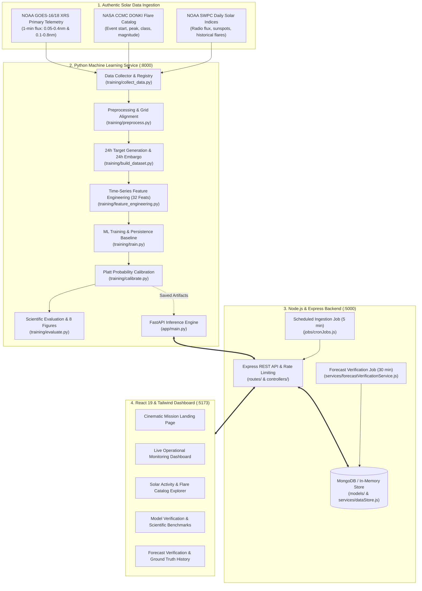

# ARKASTRA
<p align="center">

</p>

## Solar Flare Probability Forecaster
> *"Predicting the Sun. Preparing for Tomorrow."*

Arkastra is a full-stack space weather intelligence and calibrated machine learning forecasting platform. It ingests authentic solar X-ray flux measurements (from NOAA GOES-16 and GOES-18 satellites) and solar flare event catalogs (NASA CCMC DONKI and NOAA SWPC), extracts time-series solar activity dynamics, trains calibrated classification models, and delivers operational 24-hour M-class and stronger ($M1.0+$, peak flux $\ge 10^{-5}\text{ W/m}^2$) flare probability forecasts alongside a rigorous persistence baseline.

---

## 1. System Architecture



---

## 2. Scientific Evaluation & Baseline Benchmark

All models were evaluated on an **untouched chronological test partition** comprising 1,850 consecutive hourly observation records, separated from training and validation windows by a **24-hour purged temporal embargo** to eliminate lookahead and label leakage.

### Benchmark Comparison Table (Untouched Test Partition)

| Metric | Arkastra Calibrated ML | Persistence Baseline | Scientific Interpretation |
| :--- | :---: | :---: | :--- |
| **Brier Score** | **0.1607** | 0.2033 | **Lower is better.** Measures mean squared error between probabilities and binary event outcomes. |
| **Brier Skill Score (BSS)** | **+0.2096** | 0.0000 | **+21.0% skill improvement over baseline.** Statistically confirms ML superiority over persistence. |
| **True Skill Statistic (TSS)** | **0.3657** | 0.3285 | Evaluated at validation-tuned threshold ($t^* = 0.48$). $\text{TSS} = \text{Sensitivity} + \text{Specificity} - 1$. |
| **ROC-AUC** | **0.7764** | 0.6643 | Area under Receiver Operating Characteristic across all operating points. |
| **PR-AUC** | **0.9160** | 0.8300 | Area under Precision-Recall curve under class balance. |
| **Precision** | **85.3%** | 84.3% | True positive accuracy among all forecast alarm events. |
| **Recall / Sensitivity** | **83.5%** | 83.0% | Percentage of all strong flare events ($M1.0+$) successfully anticipated within 24h. |
| **Specificity** | **53.1%** | 49.9% | True negative rate on quiet solar intervals. |
| **F1 Score** | **0.8436** | 0.8365 | Harmonic mean of precision and recall. |

---

## 3. Technology Stack

### Frontend Layer
- **Framework**: React 19 with Vite & TypeScript
- **Styling**: Tailwind CSS v4 & Lucide React
- **Visualization**: Recharts (Interactive logarithmic time-series flux curves & reference thresholds)
- **Routing & Networking**: React Router 7, Axios

### Backend Layer
- **Runtime**: Node.js v24 LTS & Express.js
- **Database**: MongoDB 7.0 via Mongoose (with automated in-memory repository fallback for instant local dev)
- **Security & Utilities**: JWT authentication, bcryptjs, Helmet, Express Rate Limit, Morgan, Zod
- **Scheduling**: `node-cron` (5-minute live telemetry polling, 30-minute 24h forecast verification)

### Machine Learning & Data Pipeline
- **Runtime**: Python 3.11+ & FastAPI
- **Libraries**: Pandas, NumPy, Scikit-learn, XGBoost, Joblib, SciPy, Matplotlib, PyArrow
- **Calibration**: Platt Scaling (Sigmoid Logistic Calibration) & Isotonic Regression
- **Baseline**: Laplace-smoothed Conditional Persistence Forecaster:
  $$P(\text{M}^+ \text{ in next 24h} \mid \text{recent 24h active state})$$

---

## 4. Feature Engineering Matrix (32 Features)

Features look **strictly backward** relative to observation timestamp $t$:

1. **Direct & Logarithmic Fluxes**:
   - $F_{\text{long}}$ ($0.1\text{--}0.8\text{ nm}$), $F_{\text{short}}$ ($0.05\text{--}0.4\text{ nm}$)
   - $\log_{10}(F_{\text{long}})$, $\log_{10}(F_{\text{short}})$ (with safe numerical floor at $10^{-9}\text{ W/m}^2$)
   - Short-to-long wavelength flux ratio: $R = F_{\text{short}} / F_{\text{long}}$
2. **Multi-Scale Rolling Extrema & Volatility**:
   - Rolling maxima: $\max_{1\text{h}}$, $\max_{3\text{h}}$, $\max_{6\text{h}}$, $\max_{12\text{h}}$, $\max_{24\text{h}}$
   - Rolling means: $\mu_{6\text{h}}$, $\mu_{12\text{h}}$, $\mu_{24\text{h}}$
   - Rolling standard deviation (magnetic volatility): $\sigma_{24\text{h}}$
3. **Flux Dynamic Gradients & Second Derivatives**:
   - First derivative (rate of flux increase): $\frac{dF}{dt}_{1\text{h}}$, $\Delta F_{3\text{h}}$, $\Delta F_{6\text{h}}$
   - Second derivative (flux acceleration): $\frac{d^2F}{dt^2}_{3\text{h}}$
   - Flux volatility ratio: $F_{\text{long}} / (\mu_{24\text{h}} + \epsilon)$
4. **Historical Precursor Activity**:
   - $M^+$ flare counts in previous 6 hours, 24 hours, and 7 days
   - $X$ flare counts in previous 24 hours
   - Hours elapsed since last recorded $M^+$ flare and $X$ flare
5. **Astronomical & Cyclical Encodings**:
   - Cyclical hour: $\sin(2\pi \cdot h / 24)$, $\cos(2\pi \cdot h / 24)$
   - Cyclical day-of-year: $\sin(2\pi \cdot \text{doy} / 365.25)$, $\cos(2\pi \cdot \text{doy} / 365.25)$

---

## 5. Quickstart & Installation

### Option A: Local Development Setup

#### 1. Python ML Service Setup
```bash
# From repository root
cd ml-service
python -m venv venv

# Windows
.\venv\Scripts\activate
# Linux/macOS
source venv/bin/activate

pip install -r requirements.txt

# Run ML test suite
pytest tests/

# Start FastAPI service
python -m uvicorn app.main:app --port 8000 --reload
```

#### 2. Node.js Backend Setup
```bash
cd backend
npm install

# Run backend integration tests
npm test

# Start Express backend (includes automated in-memory DB fallback)
npm start
```

#### 3. Frontend Setup
```bash
cd frontend
npm install

# Build & verify TypeScript
npm run build

# Start Vite dev server
npm run dev
```

Visit `http://localhost:5173` in your browser.

---

### Option B: Docker Compose Deployment

Run the complete multi-tier application stack with a single command:

```bash
docker-compose up --build -d
```

Services initialized:
- `arkastra-frontend`: http://localhost:5173
- `arkastra-backend`: http://localhost:5000
- `arkastra-ml-service`: http://localhost:8000
- `arkastra-mongodb`: localhost:27017

---

## 6. Model Training & Pipeline Commands

To re-run the complete scientific pipeline from scratch:

```bash
# 1. Real Solar Data Ingestion (NOAA SWPC & NASA DONKI)
python ml-service/training/collect_data.py 2023-01-01 2024-06-01

# 2. Chronological Grid & Target Generation (24h horizon, 24h embargo)
python ml-service/training/build_dataset.py

# 3. Feature Engineering & 9 Scientific EDA Figures
python ml-service/training/feature_engineering.py

# 4. Model Training, Calibration & Baseline Fitting
python ml-service/training/train.py

# 5. Scientific Evaluation on Untouched Test Set & 8 Figures
python ml-service/training/evaluate.py
```

---

## 7. REST API Endpoints

### Express Backend (`http://localhost:5000/api`)

| Method | Endpoint | Description |
| :--- | :--- | :--- |
| `GET` | `/health` | Backend, database, and ML service connectivity health |
| `GET` | `/dashboard/overview` | Aggregated live telemetry, latest forecast, and recent flares |
| `GET` | `/dashboard/current-flux` | Current GOES flux, flare classification, and data freshness |
| `GET` | `/dashboard/forecast` | Current 24-hour calibrated M-class+ forecast |
| `GET` | `/solar/flux` | Rolling X-ray flux telemetry stream |
| `GET` | `/solar/events` | Historical flare catalog with class filtering |
| `POST` | `/forecast/predict` | Generate real-time forecast from telemetry vector |
| `GET` | `/forecast/history` | Paginated forecast verification history |
| `GET` | `/model/metrics` | Scientific Brier, BSS, TSS, ROC-AUC evaluation report |
| `GET` | `/model/baseline-comparison` | Persistence baseline benchmark metrics |
| `GET` | `/model/metadata` | Training timestamp, algorithm, and sample counts |
| `GET` | `/model/feature-importance`| Explainability feature weights |

### FastAPI ML Service (`http://localhost:8000`)

| Method | Endpoint | Description |
| :--- | :--- | :--- |
| `GET` | `/health` | Model loading status, Python version, and model name |
| `POST`| `/predict` | Ingests observation telemetry, returns calibrated probability |
| `GET` | `/metrics` | Untouched test evaluation metrics |
| `GET` | `/baseline`| Fitted persistence baseline conditional probabilities |
| `GET` | `/model/metadata` | Model hyperparameters and training data range |

---

## 8. Product Risk Categories

Product-level risk thresholds for operational space weather monitoring:

| Category | Calibrated Probability Range | Operational Interpretation |
| :--- | :---: | :--- |
| **LOW** | $0\% \text{ to } 10\%$ | Quiet Sun. Baseline solar background with negligible flare probability. |
| **MODERATE** | $10\% \text{ to } 30\%$ | Nominal active region activity. Minor pre-flare flux perturbations. |
| **HIGH** | $30\% \text{ to } 60\%$ | Elevated flare risk. Complex magnetic field geometry or recent M-class precursors. |
| **CRITICAL** | $60\% \text{ to } 100\%$ | High probability of major flare event within 24h. Significant space weather alert. |

*Disclaimer: Product risk categories are informational decision thresholds and do not replace official NOAA Space Weather Prediction Center warnings.*

---

## 9. Verification & Automated Test Suites

All modules feature comprehensive automated test suites:

- **ML Service Tests**: `pytest ml-service/tests/` (14 passing tests)
  - `test_data_sources.py`: NOAA & NASA adapter schema validation, unit conversions
  - `test_target_generation.py`: 24h forward labeling window, 24h embargo boundary isolation
  - `test_features.py`: Feature dimension integrity, absence of NaNs, backward lookback guarantees
  - `test_training.py`: Artifact loading, probability range constraints $[0, 1]$, baseline predictions
  - `test_evaluation.py`: Mathematical correctness of Brier Score, BSS, TSS
  - `test_api.py`: FastAPI endpoint responses, Pydantic schema validation
- **Backend Tests**: `npm test` inside `backend/` (9 passing tests)
  - `tests/api.test.js`: Health routes, dashboard telemetry, solar events, forecast history, auth
  - `tests/services.test.js`: Forecast verification engine, DataStore retrieval and fallback
- **Frontend Verification**: `npm run build` inside `frontend/` (Zero TypeScript or compilation errors)

---

## 10. Scientific Limitations & Future Scope

1. **Magnetogram Integration**: Future versions will ingest SDO/HMI magnetograms to extract active region magnetic complexity ($\beta, \gamma, \delta$ configurations) directly into CNN-based embeddings.
2. **Flare Location Forecasting**: Current forecasting estimates global disk flare likelihood; spatial localization to specific NOAA Active Regions (ARs) is planned for Arkastra v2.
3. **Independent X-Class Modeling**: While M-class and stronger flares ($M1.0+$) have sufficient sample volume, extreme X-class flares ($X1.0+$) remain rare. A dedicated extreme-value theory (EVT) model is under investigation.

---

## License
MIT License. Developed for advanced scientific space weather intelligence.
